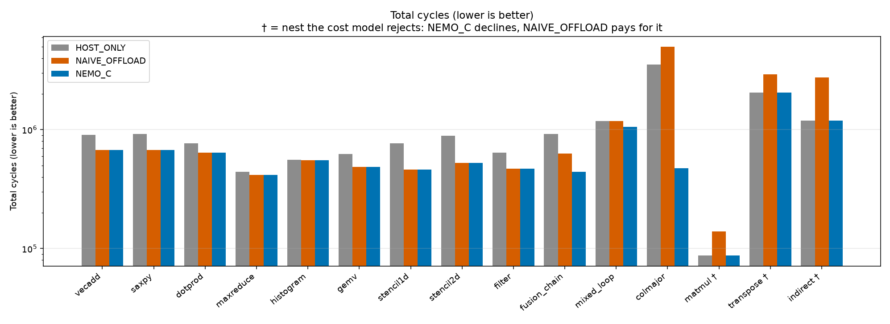

# NEMO-C

A **near-memory-aware compiler**. It reads a small loop-and-array language (`.nmc`),
analyses every loop nest, decides which nests are worth running on
**processing-in-memory (PIM)** hardware, and generates host orchestration code plus
DPU kernel code for the ones it selects. The decision comes from a cost model, not a
syntactic pattern -- and the project's evidence that the model works is three
benchmarks the compiler correctly *declines* to offload.

University Compiler Design course project. Everything is built from scratch in C++17
with flex and bison and the standard library -- no LLVM, no Boost.

## The result in one picture

`make run-all` simulates every benchmark under three configurations and verifies each
is **bit-identical** to the plain host execution:

| config | what it does |
|---|---|
| `HOST_ONLY` | everything on the host CPU |
| `NAIVE_OFFLOAD` | offload every parallel loop, ignoring the cost model |
| `NEMO_C` | cost-model-guided, with fission / interchange / fusion |



The three nests the cost model rejects are marked **†**: there `NAIVE_OFFLOAD` is
**slower in cycles** than `HOST_ONLY` (matmul 0.63x, transpose 0.70x, indirect 0.43x), while
`NEMO_C` matches `HOST_ONLY` exactly because it declines. See
[`results/decisions.md`](results/decisions.md) for every verdict with the numbers behind
it, [`results/transformations.md`](results/transformations.md) for what fission,
interchange and fusion bought, and [`docs/simulator_model.md`](docs/simulator_model.md)
for why the model produces these results.

## Build, test, run

Needs a C++17 compiler, GNU `make`, `flex` and `bison`. (On Windows this repository is
built inside WSL Ubuntu.) `plot.py` additionally needs `matplotlib`; it is the only
thing outside the compiler.

```bash
make              # build ./nemoc
make demo         # tour of the front end on saxpy
make test         # eight unit-test programs (a few minutes: they simulate every benchmark)
make run-all      # compile + simulate every benchmark -> results/, docs/graphs/
make clean
```

### The `nemoc` command line

```text
./nemoc prog.nmc                        lex + parse + check, print the AST
./nemoc prog.nmc --dump tokens          the token stream with line:col
./nemoc prog.nmc --dump ast|ir          the AST / the unoptimised three-address IR
./nemoc prog.nmc --dump opt             the IR after all five classical passes
./nemoc prog.nmc --dump constfold|cse|dce|indvar|strength
                                        one pass: IR before, the pass's analysis, IR after
./nemoc prog.nmc --dump affine          access matrices F and offsets c
./nemoc prog.nmc --dump deps            dependences, GCD vs Banerjee verdicts, parallel loops
./nemoc prog.nmc --decisions            one OFFLOAD/REJECT record per nest
./nemoc prog.nmc --explain <kernel>     the complete decision trace in plain English
./nemoc prog.nmc --transformations      fission / interchange / fusion log
./nemoc prog.nmc --partition            how each offloaded nest is cut across the DPUs
./nemoc prog.nmc --coherence            flush/invalidate placement with the dataflow table
./nemoc prog.nmc --codegen              write build/<kernel>_host.c and build/<nest>_dpu.pim
./nemoc prog.nmc --dump regalloc --regs 6   live intervals, colouring order, spills
./nemoc prog.nmc --emit-dot cfg|deps|interference   Graphviz files in build/dot/
./nemoc prog.nmc --simulate [--csv f]   three configurations, verified, with a table
```

A good first five minutes: `--decisions` on `benchmarks/matmul.nmc` and
`benchmarks/saxpy.nmc`, then `--explain matmul`, then `--simulate` on the same two.

## What each pass does and which classical algorithm it is

Every source file opens with a comment naming the concept and the algorithm.

### Front end
| file | concept |
|---|---|
| [`lexer.l`](src/lexer.l) | regular expressions -> DFA, maximal munch, keyword-before-identifier ordering, exact line/column tracking |
| [`parser.y`](src/parser.y) | LALR(1) bottom-up parsing; **0 conflicts** (`%expect 0`); operator-precedence disambiguation; panic-mode error recovery |
| [`ast.h`](src/ast.h) | the AST as tagged structs (enum kind + field superset), no class hierarchy |
| [`symtab.cpp`](src/symtab.cpp) | scoped symbol table, most-closely-nested-scope lookup |
| [`semantic.cpp`](src/semantic.cpp) | name resolution + bottom-up type synthesis; all errors collected with file:line:col |

### IR and classical optimisations
| file | concept |
|---|---|
| [`ir.h`](src/ir.h), [`lower.cpp`](src/lower.cpp) | three-address code at the statement level, **structured** (nested) loops and if/else |
| [`cfg.cpp`](src/cfg.cpp) | basic blocks and flow graph built on demand; merge blocks and loop back edges |
| [`opt_constfold.cpp`](src/opt_constfold.cpp) | constant propagation/folding: forward data-flow, lattice UNDEF / CONST / NAC |
| [`opt_cse.cpp`](src/opt_cse.cpp) | local common-subexpression elimination via available expressions |
| [`opt_dce.cpp`](src/opt_dce.cpp) | backward live-variable analysis, dead-code elimination |
| [`opt_indvar.cpp`](src/opt_indvar.cpp), [`opt_strength.cpp`](src/opt_strength.cpp) | basic/derived induction variables; strength reduction of `i*c` to an additive update |

### Near-memory analyses and transformations
| file | concept |
|---|---|
| [`pass_affine.cpp`](src/pass_affine.cpp) | affine subscripts: access matrix **F** and offset **c** per reference (`f(i) = F·i + c`) |
| [`pass_dependence.cpp`](src/pass_dependence.cpp) | **GCD test** and **Banerjee bounds test** (each reported separately), direction vectors, flow/anti/output classification, parallelism, reduction recognition |
| [`pass_profitability.cpp`](src/pass_profitability.cpp) | roofline model + Wolf-Lam reuse analysis; the decision rule; `--explain` |
| [`pass_fission.cpp`](src/pass_fission.cpp) | **Allen-Kennedy loop distribution**: SCCs by **Tarjan's algorithm**, topological order, one loop per SCC |
| [`pass_interchange.cpp`](src/pass_interchange.cpp) | loop permutation, legality on direction vectors |
| [`pass_fusion.cpp`](src/pass_fusion.cpp) | loop fusion, legality by the dependence graph, bytes saved |
| [`pass_partition.cpp`](src/pass_partition.cpp) | **owner-computes** partitioning, halo analysis, block / cyclic / block-cyclic costed |
| [`pass_coherence.cpp`](src/pass_coherence.cpp) | forward data-flow over the CFG, lattice = sets of arrays, meet = union ([write-up](docs/coherence_analysis.md)) |

### Back end
| file | concept |
|---|---|
| [`codegen_dpu.cpp`](src/codegen_dpu.cpp) | instruction selection for the PIM ISA, **scratchpad tiling** (the arithmetic is in the generated file) |
| [`regalloc.cpp`](src/regalloc.cpp) | **Chaitin-Briggs graph colouring**: liveness, interference graph, Briggs-conservative coalescing, simplify, optimistic select, spill by cost/degree, K = 24 |
| [`codegen_host.cpp`](src/codegen_host.cpp) | host orchestration C: partition setup, DMA in, launch, DMA out, merge, flush/invalidate |
| [`dpu_interp.cpp`](src/dpu_interp.cpp) | runs the *generated* DPU programs -- translation validation |
| [`simulator.cpp`](src/simulator.cpp) | functional execution + host cache model + DPU/DMA/bank-conflict model + coherence checker |

## The offload decision rule

```
OFFLOAD  iff  arithmetic intensity < MACHINE_BALANCE (0.5 flop/byte)
         and  no reference has significant self-temporal reuse
         and  the outermost loop is parallel by direction-vector analysis (or a recognised reduction)
         and  the class is not IRREGULAR
         and  the nest can be partitioned across DPUs (no all-to-all shuffle)
         and  the nest is big enough to amortise the launch:
              est. host cycles  >  LAUNCH_OVERHEAD + bytes * DMA_PER_BYTE
```

The last clause is the size check: the estimate is `lines * HOST_DRAM_ACCESS +
accesses * HOST_CACHE_HIT + flops`, and the right-hand side is what PIM pays even for no
work. A perfectly offloadable 256-element loop (`tests/tiny_size.nmc`) is therefore kept
on the host; the same loop at 16384 elements (saxpy) is offloaded.

Classes: ELEMENTWISE, REDUCTION, STENCIL, COMPUTE_BOUND, IRREGULAR -- decided from
direction vectors and access matrices, never from syntax.

## Deviations from the brief, and why (read these before the viva)

1. **One `stmt` non-terminal.** The brief's grammar splits `stmt` / `hstmt` (call and
   print host-only) but its own example puts `print` inside a host `if`, which that
   grammar cannot derive. "Host-only" is context-sensitive, so the grammar accepts the
   superset and `semantic.cpp` rejects `call`/`print` in a kernel.
2. **Self-temporal reuse must be *significant*.** Read literally, "no reference has a
   zero column in F" rejects `gemv` (the vectors `x` and `y` are reused) although the
   brief expects it to offload. The rule here counts reuse only for a stream carrying at
   least `REUSE_SIGNIFICANCE` (10%) of the traffic: in `gemv` the matrix is >98% of the
   bytes and has no reuse; in `matmul` each of A, B and C is a third.
3. **Float reductions across DPUs are rejected.** Partial sums would be added in a
   different order, so the result would not be bit-identical. `dotprod` therefore
   accumulates integers. An inner reduction that stays inside one DPU (gemv) is fine.
4. **A few additions to the PIM ISA** (compares, `MOV`, `MIN`, `ARG`/`RET`, `FILL`, `.F`
   variants) -- the minimal list in the brief cannot express a conditional or a max.
5. **Constants added to `config.h`** (launch overhead, DMA segment cost, multiply cost,
   cache size, ...), each with a justification in the file.
6. **Fusion requires both loops to use the same index-variable name; fission refuses
   loops that contain strength-reduced accumulators; CSE across source statements ties
   them together for fission.** Documented limits, not bugs.

## Layout

```
src/          the compiler (see the tables above)
benchmarks/   the 15 programs: 14 from the brief + colmajor (loop interchange)
tests/        unit-test programs, demo inputs (bad_*.nmc, dep_banerjee.nmc, coherence_demo.nmc, tiny_size.nmc)
results/      results.csv, decisions.md, transformations.md, cycles/bytes/energy.png
docs/         coherence_analysis.md, simulator_model.md, graphs/ (Graphviz .dot files)
scripts/      run_all.sh  (make run-all)
plot.py       renders the CSV with matplotlib; independent of the compiler
```

Render a Graphviz file with `dot -Tpng docs/graphs/saxpy_main.cfg.dot -o cfg.png`
(Graphviz is not needed to build or run anything).
